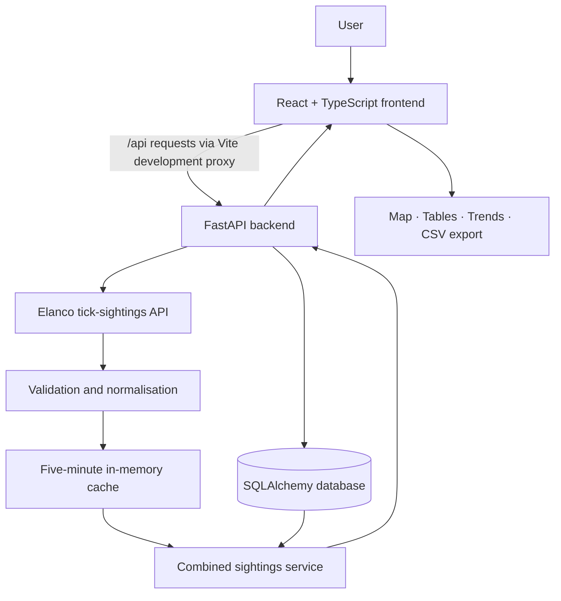

# 🌿 Elanco Tick Tracker

**Explore · Report · Understand UK Tick Sightings**

*A full-stack tick-sighting surveillance and data exploration application*

Built with **React, TypeScript, FastAPI and SQLAlchemy** as part of the **Elanco Software Engineering Technical Assessment**.

[Web App (local)](http://localhost:5173) · [API (local)](http://127.0.0.1:8000) · [Swagger API Docs](http://127.0.0.1:8000/docs) · [GitHub Repository](https://github.com/Hosnaa-gh/Elanco-tick-tracker)

[Explore Features](#features) · [Get Started](#getting-started) · [API Reference](#api-reference) · [Testing](#testing)

---
## 🎥 Video Demonstration

A complete video walkthrough of the Elanco Tick Tracker full-stack application is available below.

The demonstration covers the main application features, interactive data visualisations, tick sighting reporting, and backend API operations.

**[▶ Watch the Full-Stack Technical Assessment Demonstration](https://youtu.be/aqTm5UaIH28)**

> **Local development links:** The web app and API links above work only after starting the frontend and backend on your computer. Vite may use a different port (such as `5174`) if `5173` is occupied. No public deployment URL is configured in this README.

## Overview

**Elanco Tick Tracker** makes tick-sighting records across the United Kingdom easier to explore and understand. It brings together sightings retrieved from the Elanco assessment API and reports submitted through the application, presenting them through an interactive dashboard, map, searchable records and trend visualisations.
The project demonstrates an end-to-end software engineering workflow: integrating an external API, validating and normalising data, persisting user submissions, designing REST endpoints, building a responsive interface and writing automated tests.
> **Data disclaimer:** This is a data-exploration and reporting application, not a medical diagnostic tool or a complete measure of tick prevalence. Reported sightings depend on the available data and may be geographically or temporally uneven.

## Features

| Area | Capabilities |

| --- | --- |

| **Dashboard** | Overview metrics, interactive map, species/date filters, sighting trends and backend connectivity indicator |

| **Tick Sightings** | Browse combined records, search and filter by location, species, source and dates, with pagination |

| **Report Sighting** | Submit a tick observation with a date, location, species and optional scientific name; receive server-side validation |

| **Insights & Trends** | Regional comparisons and weekly/monthly trend charts |

| **Data Export** | Download the currently filtered, loaded sightings as a CSV file |

| **About & Help** | Feature guidance, getting-started instructions, FAQs and data limitations |

| **Backend** | CRUD endpoints for user reports, combined data endpoint, filters, pagination, error handling and automated tests |

| **Tick Identification Guide** | Educational profiles covering all seven species labels in the loaded dataset, including identification characteristics, habitats and More links to official tick information. |

| **Tick Bite Prevention** | Practical guidance on reducing tick exposure, checking for bites and removing attached ticks safely. |

| **Seasonal Sightings by Location** | Interactive monthly sighting chart with location and species selection, calculated from loaded reports rather than simulated data. |

### Engineering highlights

- **External API integration:** asynchronous requests to the Elanco tick-sightings endpoint using HTTPX, with a request timeout and response-format checks.
- **Data quality:** validation, date normalisation, whitespace cleanup and deduplication of external records.
- **Unified dataset:** merges external sightings with database-backed user reports, labels their sources and prefixes identifiers to prevent cross-source collisions.
- **Resilience:** a five-minute in-memory cache for external sightings, guarded by an asynchronous lock; previously cached data can be used when the upstream service is temporarily unavailable.
- **Persistence:** SQLAlchemy models with UUID report identifiers and indexes on location, date and species; Alembic manages schema migrations.
- **Validation:** Pydantic checks submitted report fields and rejects future sighting dates.
- **Data access:** server-side filtering and bounded pagination for report and combined-sighting endpoints.
- **Responsive frontend:** React-based interface with interactive Leaflet maps, Recharts visualisations and Lucide icons.
- **Data-driven species guide:** Dynamically displays species labels found in the loaded sightings, while distinguishing common names from scientific names.
- **Seasonal analysis:** Aggregates reported sightings by calendar month for selected locations and species. Report counts are not treated as a direct measure of actual tick abundance.

## Tech Stack

| Layer | Technologies |

| --- | --- |

| Frontend | React 19, TypeScript 5, Vite 8, CSS |

| Mapping | Leaflet, React Leaflet |

| Charts | Recharts |

| Icons | Lucide React |

| Backend | Python 3.10+, FastAPI, Uvicorn |

| API client | HTTPX |

| Database | SQLAlchemy 2, SQLite by default |

| Migrations | Alembic |

| Validation | Pydantic 2 |

| Testing | Pytest, FastAPI TestClient |

## Architecture



The frontend requests the combined dataset in pages, then computes some dashboard and visualisation summaries from the loaded records. Separate backend insights endpoints aggregate **locally stored user reports**; they should not be confused with frontend summaries derived from the combined dataset.

### Data flow

1. The frontend calls `GET /api/sightings/combined` in batches.
2. The backend retrieves and processes external Elanco sightings, using the cache where appropriate.
3. The combined service loads locally submitted reports from the database.
4. Records are assigned source-aware IDs, deduplicated, filtered and paginated.
5. The frontend presents the resulting records through the dashboard, map, explorer and export interface.
6. New reports are validated and saved through `POST /api/reports`.

## Project Structure

```text
Elanco-tick-tracker/
├── backend/
│   ├── main.py                 # FastAPI app and sighting endpoints
│   ├── routes.py               # Report CRUD and insights routes
│   ├── combined_sightings.py   # External + local data aggregation and cache
│   ├── elanco_client.py       # External API client
│   ├── data_processing.py     # Data cleaning and deduplication
│   ├── database.py            # Database engine and sessions
│   ├── models.py              # SQLAlchemy sighting model
│   ├── schemas.py             # Pydantic request/response schemas
│   └── crud.py                # Database operations and aggregations
├── frontend/
│   ├── public/                 # Public assets and favicon
│   ├── src/
│   │   ├── components/
│   │   │   └── TickMap.tsx     # Interactive map
│   │   ├── pages/
│   │   │   └── Dashboard.tsx
│   │   ├── App.tsx             # Main application and page views
│   │   ├── App.css
│   │   ├── index.css
│   │   └── main.tsx
│   ├── index.html
│   ├── package.json
│   └── vite.config.ts
├── migrations/
│   └── versions/              # Alembic migration scripts
├── tests/
│   ├── test_api.py
│   └── test_data_processing.py
├── alembic.ini
├── requirements.txt
└── README.md

```

## Getting Started

### Prerequisites

- **Python 3.10+**
- **Node.js** compatible with Vite 8 (Node.js 20.19+ or 22.12+)
- **npm**
- **Git**
The commands below assume you are working from the **repository root**, unless stated otherwise.

### 1. Clone the repository

```bash
git clone https://github.com/Hosnaa-gh/Elanco-tick-tracker.git
cd Elanco-tick-tracker

```

### 2. Set up the Python environment

```bash
python -m venv .venv

```

Activate it on **Windows PowerShell**:
```powershell
.\.venv\Scripts\Activate.ps1

```

Or on **macOS/Linux**:
```bash
source .venv/bin/activate

```

Install backend dependencies:
```bash
python -m pip install -r requirements.txt

```

### 3. Initialise the database

The default database is a local SQLite file named `tick_tracker.db` in the repository root. It is created/configured through SQLAlchemy and the Alembic migrations.
```bash
python -m alembic upgrade head

```

To use a different SQLAlchemy-compatible database, set the `DATABASE_URL` environment variable **before** running migrations and starting the API. Additional database drivers may be required for non-SQLite engines.

### 4. Start the backend

From the repository root:
```bash
python -m uvicorn backend.main:app --reload

```

- API root: http://127.0.0.1:8000/
- Health check: http://127.0.0.1:8000/health
- Swagger UI: http://127.0.0.1:8000/docs
- OpenAPI schema: http://127.0.0.1:8000/openapi.json

### 5. Start the frontend

Open a **second terminal** and run:
```bash
cd frontend
npm install
npm run dev

```

Open the local address shown by Vite (normally **http://localhost:5173**; a different port may be selected if it is occupied).
The development configuration proxies `/api` and `/health` requests to `http://127.0.0.1:8000`, so **keep both servers running**.

### 6. Production frontend build

From `frontend/`:
```bash
npm run build
npm run preview

```

`npm run build` runs TypeScript build checks and creates frontend assets in `frontend/dist/`. The Vite preview command serves those assets locally; it does **not** deploy or bundle the Python backend.

## API Reference

The backend exposes the following routes:
| Method | Endpoint | Description |

| --- | --- | --- |

| `GET` | `/` | API welcome and running status |

| `GET` | `/health` | Health status |

| `GET` | `/api/sightings` | Fetch and process external Elanco sightings |

| `GET` | `/api/sightings/combined` | Combine external and user-submitted sightings |

| `POST` | `/api/reports` | Create a user sighting report |

| `GET` | `/api/reports` | List locally stored reports |

| `GET` | `/api/reports/{report_id}` | Retrieve one local report |

| `PUT` | `/api/reports/{report_id}` | Replace an existing local report |

| `DELETE` | `/api/reports/{report_id}` | Delete a local report |

| `GET` | `/api/insights/by-region` | Aggregate local reports by region |

| `GET` | `/api/insights/trends` | Aggregate local reports by week or month |

### Query parameters

`GET /api/reports` and `GET /api/sightings/combined` accept:
| Parameter | Description |

| --- | --- |

| `skip` | Number of records to skip; default `0` |

| `limit` | Page size; default `50`, allowed `1–100` |

| `location` | Case-insensitive location match |

| `species` | Case-insensitive species match |

| `start_date` | Optional ISO 8601 lower date boundary |

| `end_date` | Optional ISO 8601 upper date boundary |

For example:
```http
GET /api/sightings/combined?location=London&species=Marsh&skip=0&limit=20

```

The combined endpoint returns a paginated result with `total`, `skip`, `limit` and `data`. Records also identify their source as `elanco` or `user`.
The trends endpoint supports `period=week` and `period=month` (the default).

### Example: create a report

```http
POST /api/reports
Content-Type: application/json

```
```json
{
"date": "2026-10-20T14:30:00Z",
"location": "London",
"species": "Castor bean tick",
"latinName": "Ixodes ricinus"
}

```

A successful submission returns **HTTP 201** with the saved record, including its generated `id` and `created_at` timestamp. `latinName` is optional; `date`, `location` and `species` are required.
Use the interactive [Swagger documentation](http://127.0.0.1:8000/docs) while the backend is running to inspect the complete request and response schemas.

## Validation, Reliability and Data Handling

**External records** are checked and normalised before presentation. Invalid records may be excluded, and duplicate identifiers are removed during processing. The external client checks HTTP errors, JSON decoding and the expected top-level list structure.
**User reports** are validated with Pydantic: location and species must be non-empty strings within defined length limits, the date must be parseable and cannot be in the future, and the optional scientific name has a length limit. Invalid requests receive validation responses such as **HTTP 422**.
**Missing reports** return **HTTP 404**. A failure to retrieve or decode external data on `/api/sightings` is surfaced as **HTTP 502**. The combined endpoint has a fallback to previously cached external data when available.
**Cache behaviour:** the external-data cache is **in-memory**, lasts five minutes for successful fetches and is scoped to the running backend process. It is not persistent storage or a distributed cache.

## Testing

The repository contains automated tests for the backend API and data-processing logic, including:
- Health and root endpoints
- Successful external-data retrieval and upstream failures
- Report creation, listing, retrieval, update and deletion
- Missing reports and invalid submissions
- Location, species and date filtering
- Pagination and invalid date ranges
- Region aggregation and weekly/monthly trends
- Invalid insights periods and empty-database behaviour
- Data cleaning and deduplication
**Verified backend test results: 28 passed in 3.76 seconds (Pytest).** All 28 collected test cases completed successfully, including parameterised cases. This result is supported by the final VS Code terminal output captured on 1 November 2026.
Run from the repository root:
```bash
python -m pytest tests/ -v

```

The API tests use a separate in-memory SQLite database for report operations, avoiding reliance on the application's local database file.
Frontend checks available in `frontend/package.json`:
```bash
cd frontend
npm run lint
npm run build

```

## Current Scope and Limitations

- The upstream Elanco service is an external dependency; availability and record quality are outside this project's control.
- The SQLite database file is local by default and is not included in the supplied project archive.
- The cache is process-local and resets when the backend restarts.
- The backend insights endpoints aggregate **local reports**; the frontend also computes summaries from the combined dataset.
- The CSV export uses the currently loaded and filtered frontend records.
- No authentication or role-based access control is implemented for report CRUD endpoints. The current implementation is intended as an assessment/demo application, not a production public reporting service.
- There is no deployment configuration or automated CI/CD workflow included in the reviewed project files.

## Potential Improvements

- Add authentication, authorisation and abuse prevention for public reporting endpoints.
- Add frontend component and end-to-end tests.
- Add CI checks for linting, testing and builds.
- Improve loading and error-state accessibility.
- Introduce server-side or incremental analytics for larger datasets.
- Add deployment configuration, monitoring and production-ready cache/storage options.

## Author

**Seyedehhosna Ghoreishiamrei**

BSc Computer Science — Brunel University London
GitHub: [@Hosnaa-gh](https://github.com/Hosnaa-gh)

---

*Created for the Elanco Software Engineering Technical Assessment.*
